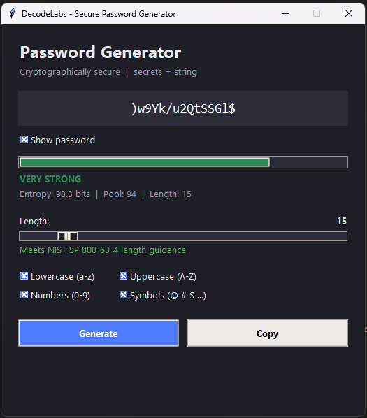
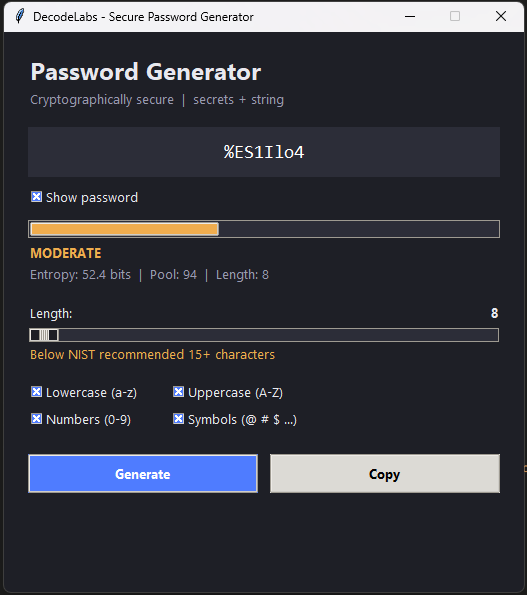
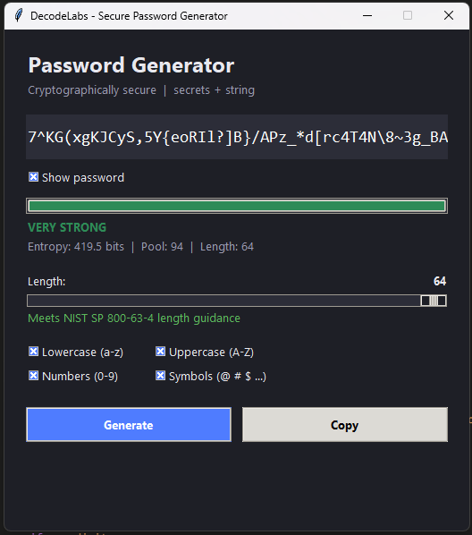
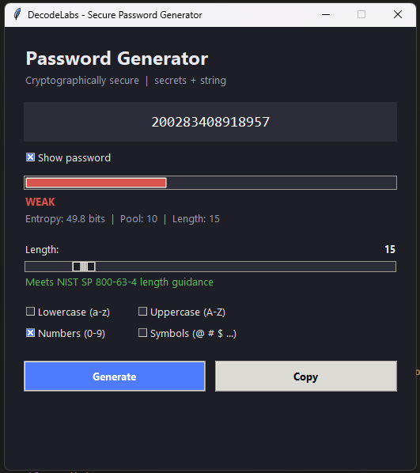
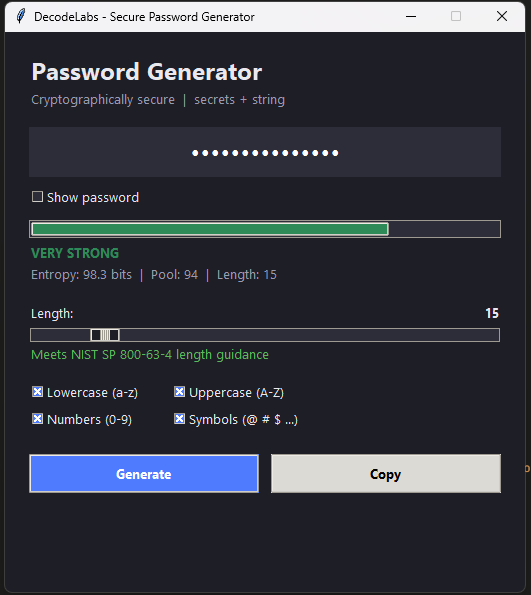

# Random Password Generator (DecodeLabs Project 3)

Secure password generator with a GUI and a CLI.

## Features
- Cryptographically secure randomness via `secrets` (not `random`)
- Character pools from the `string` module
- `''.join()` for O(N) string building
- Input validation (8-64 characters, NIST 15+ recommended)
- Guarantees at least one character from each selected type
- Entropy calculation: E = L x log2(R), with strength meter

## Run
    python main.py          # GUI
    python main.py --cli    # terminal

## Requirements
Python 3.6+ (tkinter included on Windows/Mac; Linux: `sudo apt install python3-tk`)

## Structure
    main.py       entry point
    generator.py  core logic
    gui.py        tkinter interface
    cli.py        terminal interface
    ## Screenshots

**Default view (length 15, all character types)**

**Minimum length (8) with NIST warning**

**Maximum length (64)**

**Numbers only (WEAK rating)**

**Password hidden**
